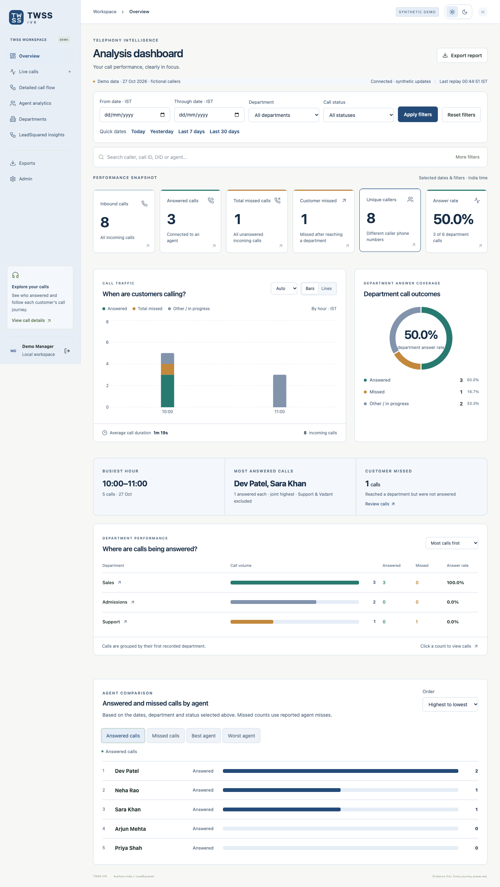
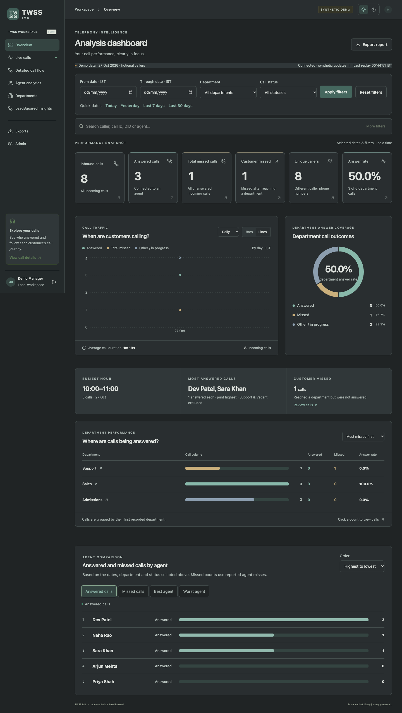
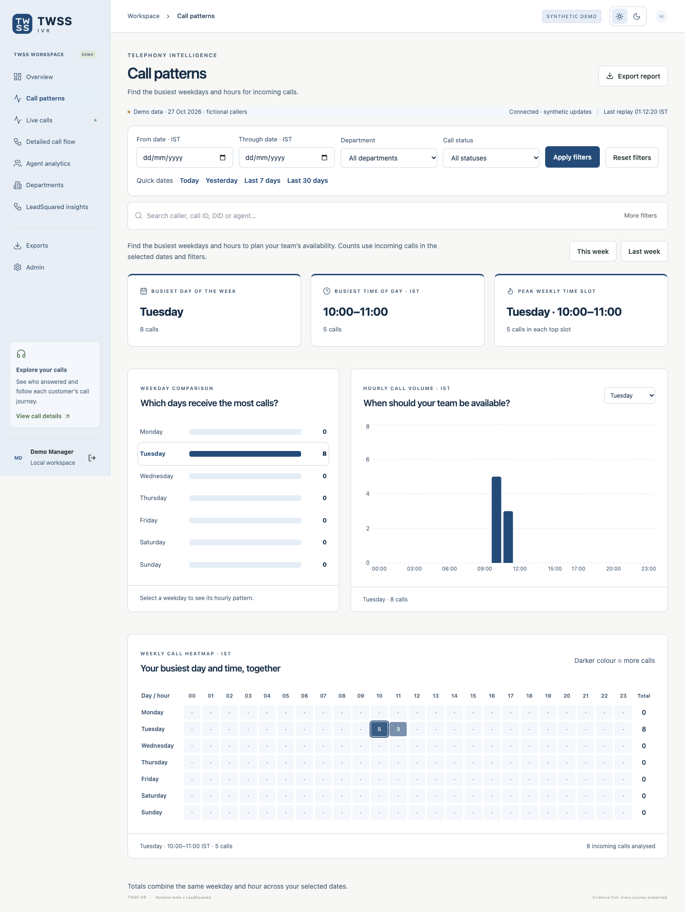

# P-02 — Product Walkthrough

Baseline: 2026-10-30 · Status: **As-built draft — review pending**

Proposed responsible function: Product / Design. No named assignment or approval is implied.

## Start the walkthrough
Open the Mac app at http://localhost:8001 and sign in with your assigned account. Use the synthetic preview for demonstrations; do not distribute customer screenshots. The images linked below were captured from fictional fixtures, not the live account.

## Screen tour
| Screen | Business question | Main action |
|---|---|---|
| Overview | How well are incoming calls being handled? | Click a KPI to inspect calls |
| Call patterns | Which weekday and hour bring the most calls? | Choose a week and inspect the heatmap |
| Live calls | Are any stored calls marked in progress? | Inspect records; this is not verified real-time telephony |
| Detailed call flow | What happened during a call? | Expand timeline or open the call drawer |
| Agent analytics | Who answered or missed calls? | Compare counts and per-agent ratios |
| Departments | Where were calls attributed? | Compare first-department totals |
| LeadSquared insights | Does the caller have a lead, and who owns it? | Review creation date, current stage and owner name |
| Exports / Admin | How do we share reports and manage access? | Export if permitted; manage staff as Admin |

## Demonstration sequence
1. Choose a historical day on Overview and inspect total calls and department answer rate.
2. Open Call patterns, select Last week, and inspect the busiest weekday and hour.
3. Open a call and examine provider-reported agent activity. Missing evidence is not invented.
4. Open LeadSquared insights. The default is all answered calls. Set Missed to reveal All missed calls and Missed after department selection.
5. Visit another tab: its filters stay independent. Return to restore the first tab's applied choices.

## Visual material
[Overview — synthetic light](../assets/overview-light.png), [Overview — synthetic dark](../assets/overview-dark.png), [Call patterns — synthetic](../assets/call-patterns-light.png).

The interactive application is the demonstration. This pack does not reproduce the other project's HTML prototype or import its learning-platform requirements.

---
Evidence: frontend/src/main.tsx; frontend/src/AnalysisDashboard.tsx; frontend/src/CallPatterns.tsx. Source baseline: `9fa87271efd5d69d2d769c519150b032df97bdf9`.

[Documentation register](../00_Documentation_Register.md)
