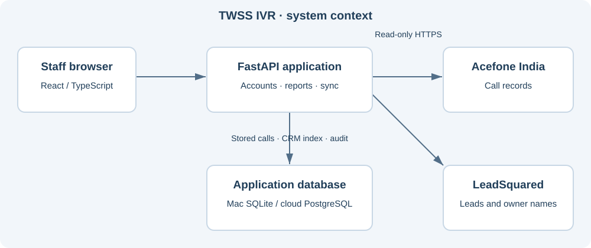
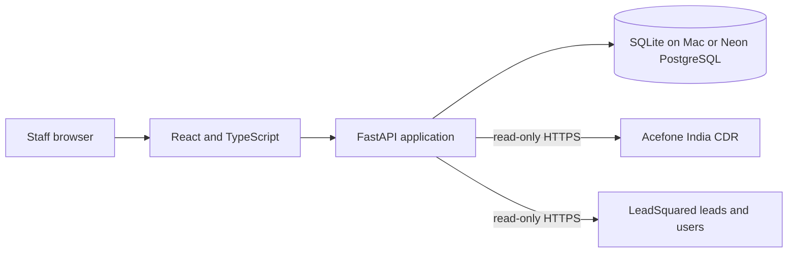

# A-01 — Software Architecture Document

Baseline: 2026-10-30 · Status: **As-built draft — review pending**

Proposed responsible function: Engineering / business owner. No named assignment or approval is implied.

## System context

The code is a modular monolith with in-process synchronization. It has a synthetic demo mode and an internal named-account mode. Current runtime does not depend on Redis/Celery, although an older optional Compose scaffold exists.

## Components and data path
The browser uses React Router query strings, TanStack Query and Recharts. FastAPI authenticates staff, applies filters/permissions and projects call/CRM reports. CDR ingestion validates root identity, preserves restricted snapshots and derives events/participants. CRM scanning stages pages before promoting the saved lead/phone directory; caller checks are bounded and resumable full indexing retains prior results.

On PostgreSQL, call reconciliation, CRM indexing and caller checks have separate locks/workers. SQLite retains serial main synchronization; direct matching is a separately defined worker, not automatically scheduled by the local serial loop. The scheduler retries transient failures. Source optimization avoids unchanged full-journey reads and unused internal UI report queries.

## Deployment and constraints
Mac: one Uvicorn process bound to 127.0.0.1:8001 and private SQLite. Cloud: Docker image, one Render Free instance, persistent Neon PostgreSQL, HTTPS origin and Secure cookies. The cloud database is quota-blocked at this baseline. Local fallback uses an independent database, not a live PostgreSQL replica. No verified event bus, cross-instance lock, real-time provider event feed or horizontal scheduler coordination is implemented.

---
Evidence: backend/app/main.py; backend/app/live_sync.py; backend/app/scheduler.py; scripts/internal.py; scripts/cloud.py. Source baseline: `9fa87271efd5d69d2d769c519150b032df97bdf9`.

[Documentation register](../00_Documentation_Register.md)
