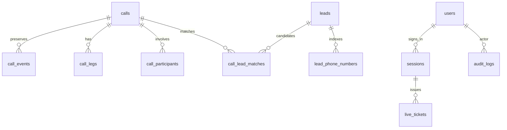

# A-03 — Data Model ERD and Data Dictionary

Baseline: 2026-10-30 · Status: **As-built draft — review pending**

Proposed responsible function: Engineering / Database. No named assignment or approval is implied.

## Storage model
SQLAlchemy declares 16 application tables. Alembic manages changes; migrations 0001 through 0007 are present. The dictionary below is generated from column/type/nullability/foreign-key metadata in db.py, without opening a tenant database.

## Interpretation
Call.projection is derived JSON, not an independent provider record. Event payloads are restricted and may be cleared by raw-data retention while identity/hash/order remain. Lead and LeadPhone hold current saved values; LeadMatch is a relation, not proof of call activity logging. IntegrationState.details can include internal owner-name mappings and index progress. CRMScanRow is a staging generation, not a user-visible second lead type.

## Classification and migration
Phone numbers, lead names, staff identities and call evidence are restricted. Token/password hashes are authentication data and must never be exported with business reports. Quarantine and backups can also contain personal data. See C-04 for handling. Do not copy a live SQLite file while writes are active; use the backup API/script. Do not treat the source dictionary as proof that a particular installation is at the expected migration revision.

### calls
| Column | SQL type | Nullable | Key / reference |
|---|---|---|---|
| `id` | `VARCHAR(120)` | no | PK |
| `provider` | `VARCHAR(30)` | no | — |
| `provider_call_id` | `VARCHAR(120)` | no | — |
| `caller_e164` | `VARCHAR(20)` | yes | indexed |
| `dialed_did` | `VARCHAR(20)` | yes | indexed |
| `direction` | `VARCHAR(10)` | no | — |
| `started_at` | `DATETIME` | yes | indexed |
| `final_status` | `VARCHAR(20)` | no | indexed |
| `projection` | `JSON` | no | — |

Unique constraint: provider, provider_call_id.

Index `ix_calls_caller_e164`: caller_e164.

Index `ix_calls_dialed_did`: dialed_did.

Index `ix_calls_final_status`: final_status.

Index `ix_calls_started_at`: started_at.

### crm_scan_rows
| Column | SQL type | Nullable | Key / reference |
|---|---|---|---|
| `lead_id` | `VARCHAR(120)` | no | PK |
| `payload` | `JSON` | no | — |

### department_mappings
| Column | SQL type | Nullable | Key / reference |
|---|---|---|---|
| `id` | `INTEGER` | no | PK |
| `source_type` | `VARCHAR(20)` | no | — |
| `source_value` | `VARCHAR(120)` | no | indexed |
| `department` | `VARCHAR(120)` | no | — |
| `effective_from` | `DATETIME` | no | — |
| `effective_to` | `DATETIME` | yes | — |

Index `ix_department_mappings_source_value`: source_value.

### integration_events
| Column | SQL type | Nullable | Key / reference |
|---|---|---|---|
| `id` | `INTEGER` | no | PK |
| `provider` | `VARCHAR(30)` | no | — |
| `received_at` | `DATETIME` | no | — |
| `status` | `VARCHAR(30)` | no | — |
| `payload` | `JSON` | no | — |
| `error` | `VARCHAR(240)` | yes | — |

### integration_state
| Column | SQL type | Nullable | Key / reference |
|---|---|---|---|
| `provider` | `VARCHAR(30)` | no | PK |
| `status` | `VARCHAR(40)` | no | — |
| `last_success_at` | `DATETIME` | yes | — |
| `last_attempt_at` | `DATETIME` | yes | — |
| `message` | `VARCHAR(240)` | yes | — |
| `details` | `JSON` | no | — |

### leads
| Column | SQL type | Nullable | Key / reference |
|---|---|---|---|
| `id` | `VARCHAR(120)` | no | PK |
| `display_name` | `VARCHAR(120)` | no | — |
| `created_at` | `DATETIME` | no | — |
| `current_stage` | `VARCHAR(80)` | no | — |
| `current_owner` | `VARCHAR(120)` | no | — |
| `source` | `VARCHAR(120)` | no | — |
| `last_synced_at` | `DATETIME` | no | — |

### sync_jobs
| Column | SQL type | Nullable | Key / reference |
|---|---|---|---|
| `id` | `INTEGER` | no | PK |
| `provider` | `VARCHAR(30)` | no | — |
| `kind` | `VARCHAR(30)` | no | — |
| `cursor` | `VARCHAR(120)` | yes | — |
| `status` | `VARCHAR(30)` | no | — |
| `started_at` | `DATETIME` | no | — |
| `completed_at` | `DATETIME` | yes | — |
| `error` | `VARCHAR(240)` | yes | — |
| `details` | `JSON` | no | — |

### users
| Column | SQL type | Nullable | Key / reference |
|---|---|---|---|
| `id` | `INTEGER` | no | PK |
| `username` | `VARCHAR(120)` | no | unique |
| `display_name` | `VARCHAR(120)` | no | — |
| `password_hash` | `VARCHAR(256)` | no | — |
| `role` | `VARCHAR(12)` | no | — |
| `active` | `BOOLEAN` | no | — |
| `must_change_password` | `BOOLEAN` | no | — |
| `failed_attempts` | `INTEGER` | no | — |
| `locked_until` | `DATETIME` | yes | — |
| `created_at` | `DATETIME` | no | — |

Unique constraint: username.

### audit_logs
| Column | SQL type | Nullable | Key / reference |
|---|---|---|---|
| `id` | `INTEGER` | no | PK |
| `at` | `DATETIME` | no | — |
| `role` | `VARCHAR(12)` | no | — |
| `action` | `VARCHAR(80)` | no | — |
| `resource` | `VARCHAR(120)` | no | — |
| `user_id` | `INTEGER` | yes | FK → users.id, indexed |

Index `ix_audit_logs_user_id`: user_id.

### call_events
| Column | SQL type | Nullable | Key / reference |
|---|---|---|---|
| `id` | `VARCHAR(64)` | no | PK |
| `provider` | `VARCHAR(30)` | no | — |
| `provider_event_id` | `VARCHAR(120)` | no | — |
| `call_id` | `VARCHAR(120)` | no | FK → calls.id, indexed |
| `event_type` | `VARCHAR(30)` | no | — |
| `event_at` | `DATETIME` | no | — |
| `received_at` | `DATETIME` | no | — |
| `dedupe_hash` | `VARCHAR(64)` | no | — |
| `payload` | `JSON` | no | — |

Unique constraint: provider, provider_event_id.

Index `ix_call_event_order`: call_id, event_at.

Index `ix_call_events_call_id`: call_id.

### call_lead_matches
| Column | SQL type | Nullable | Key / reference |
|---|---|---|---|
| `call_id` | `VARCHAR(120)` | no | PK, FK → calls.id |
| `lead_id` | `VARCHAR(120)` | no | PK, FK → leads.id |
| `match_status` | `VARCHAR(30)` | no | — |
| `snapshot_source` | `VARCHAR(30)` | no | — |
| `matched_at` | `DATETIME` | no | — |

### call_legs
| Column | SQL type | Nullable | Key / reference |
|---|---|---|---|
| `id` | `VARCHAR(241)` | no | PK |
| `call_id` | `VARCHAR(120)` | no | FK → calls.id, indexed |
| `provider_leg_id` | `VARCHAR(120)` | no | — |
| `agent` | `VARCHAR(120)` | yes | — |
| `department` | `VARCHAR(120)` | yes | — |
| `evidence` | `JSON` | no | — |

Unique constraint: call_id, provider_leg_id.

Index `ix_call_legs_call_id`: call_id.

### call_participants
| Column | SQL type | Nullable | Key / reference |
|---|---|---|---|
| `id` | `VARCHAR(64)` | no | PK |
| `call_id` | `VARCHAR(120)` | no | FK → calls.id, indexed |
| `agent_name` | `VARCHAR(120)` | yes | indexed |
| `evidence` | `JSON` | no | — |

Index `ix_call_participants_agent_name`: agent_name.

Index `ix_call_participants_call_id`: call_id.

### lead_phone_numbers
| Column | SQL type | Nullable | Key / reference |
|---|---|---|---|
| `id` | `INTEGER` | no | PK |
| `lead_id` | `VARCHAR(120)` | no | FK → leads.id |
| `normalized_number` | `VARCHAR(20)` | no | indexed |

Unique constraint: lead_id, normalized_number.

Index `ix_lead_phone_numbers_normalized_number`: normalized_number.

### sessions
| Column | SQL type | Nullable | Key / reference |
|---|---|---|---|
| `token_hash` | `VARCHAR(64)` | no | PK |
| `role` | `VARCHAR(12)` | no | — |
| `expires_at` | `DATETIME` | no | indexed |
| `user_id` | `INTEGER` | yes | FK → users.id, indexed |

Index `ix_sessions_expires_at`: expires_at.

Index `ix_sessions_user_id`: user_id.

### live_tickets
| Column | SQL type | Nullable | Key / reference |
|---|---|---|---|
| `token_hash` | `VARCHAR(64)` | no | PK |
| `session_hash` | `VARCHAR(64)` | no | FK → sessions.token_hash |
| `expires_at` | `DATETIME` | no | — |

---
Evidence: backend/app/db.py; backend/migrations/versions/. Source baseline: `9fa87271efd5d69d2d769c519150b032df97bdf9`.

[Documentation register](../00_Documentation_Register.md)
